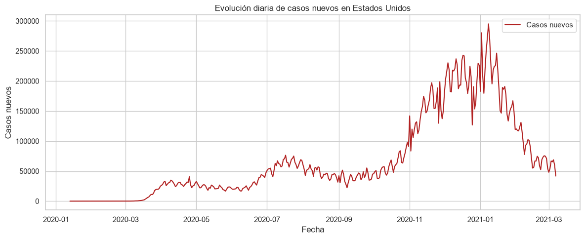
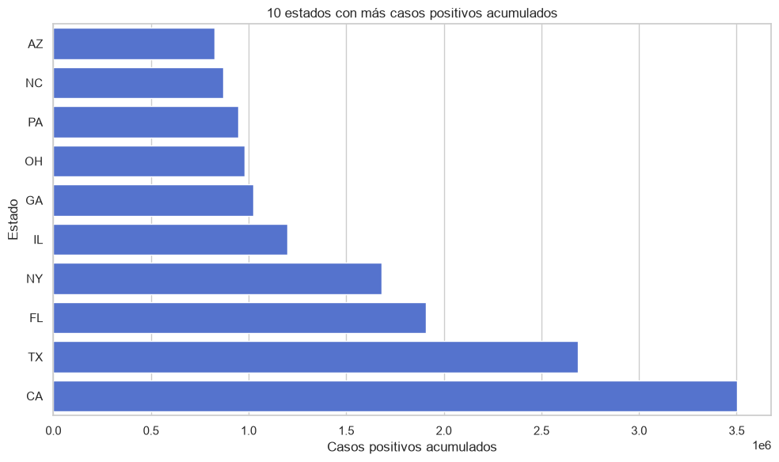
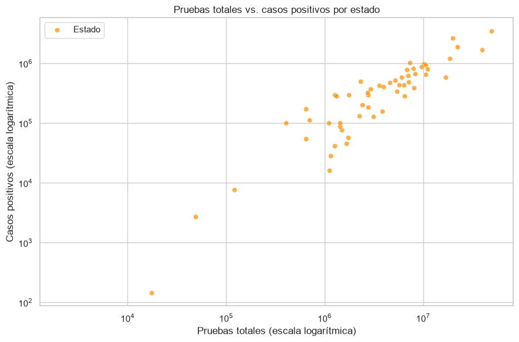

# Informe ejecutivo

## COVID-19 en Estados Unidos: qué dicen los datos (enero 2020 – marzo 2021)

## Resumen ejecutivo

Entre enero de 2020 y marzo de 2021 se registraron 20.780 observaciones diarias correspondientes a 56 estados y territorios de Estados Unidos. Al final del periodo, la suma de los últimos registros de cada estado asciende a aproximadamente **28,8 millones de casos** y **515.000 fallecimientos**.

- **La pandemia llegó en olas.** El máximo de casos nuevos se alcanzó el 8 de enero de 2021, con 295.121 casos en un solo día. Los fallecimientos alcanzaron su máximo el 12 de febrero de 2021, con 5.427 en un día.
- **El impacto está muy concentrado.** California, Texas, Florida y Nueva York reúnen el mayor número de casos acumulados del país.
- **Pruebas y casos van de la mano.** La correlación entre pruebas realizadas y casos positivos por estado es de 0,90: los estados que más prueban son también los que más casos detectan, aunque esto no demuestra causalidad.

**Recomendación principal:** antes de tomar decisiones de asignación de recursos, comparar los estados en función de su población y no solo por totales.

## 1. Los datos

La fuente es el **COVID Tracking Project**, que recopiló datos públicos de casos, pruebas, hospitalizaciones y fallecimientos por estado hasta marzo de 2021. El conjunto original tiene 20.780 filas y 56 columnas. Tras la limpieza se conservaron 10 variables relevantes, se convirtieron las fechas a formato fecha, se comprobó que no había duplicados y se trataron los valores faltantes de las series acumuladas.

## 2. Qué encontramos

### 2.1. Una evolución marcada por las olas

La serie diaria de casos nuevos muestra varios repuntes. El más alto se produjo a comienzos de 2021, tras las fiestas de fin de año. Los fallecimientos siguieron a los casos con unas semanas de retraso y alcanzaron su pico en febrero de 2021.

### 2.2. Unos pocos estados concentran la mayor parte de los casos

California lidera el ranking con unos 3,5 millones de casos, seguida de Texas (2,7 M), Florida (1,9 M) y Nueva York (1,7 M). Son también algunos de los estados más poblados, por lo que la comparación en términos absolutos debe matizarse.

### 2.3. Más pruebas se asocian con más casos detectados

Cada punto representa un estado. La relación es claramente creciente y la correlación de Pearson es 0,90. Tiene sentido: una mayor capacidad de testeo permite detectar más contagios. Sin embargo, la asociación no implica que las pruebas causen los casos; ambos indicadores crecen con el tamaño de la población y la intensidad del brote.

## 3. Conclusiones

- La COVID-19 afectó de forma desigual al país: unos pocos estados concentran la mayor parte de los casos y fallecimientos.
- La evolución temporal muestra olas claras, con un pico de casos a principios de 2021 y un pico de fallecimientos semanas después.
- Existe una relación positiva fuerte entre pruebas y casos detectados, coherente con la dinámica de detección de la enfermedad.
- El dataset original requería una limpieza importante: muchas columnas casi vacías, fechas codificadas como números y correcciones negativas en los incrementos diarios.

## 4. Recomendaciones

- Normalizar los indicadores por población antes de comparar el impacto relativo entre estados.
- Tener en cuenta las diferencias de criterio y calidad de reporte entre estados al interpretar las comparaciones.
- Monitorizar la evolución con medias móviles para suavizar correcciones puntuales y detectar tendencias reales.
- Ampliar el análisis con datos de vacunación y movilidad para entender las etapas posteriores a marzo de 2021.

## Limitaciones

Los datos son acumulados y absolutos, no están normalizados por población y dependen de las diferencias de reporte entre estados. El periodo termina en marzo de 2021, antes de la vacunación masiva, por lo que las conclusiones no describen etapas posteriores. El informe resume un análisis exploratorio y no establece relaciones causales.
