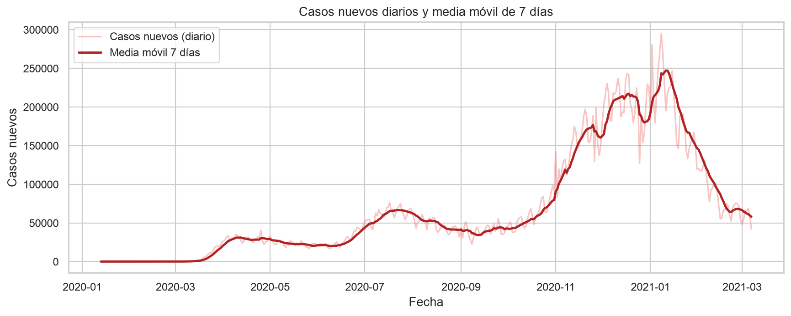
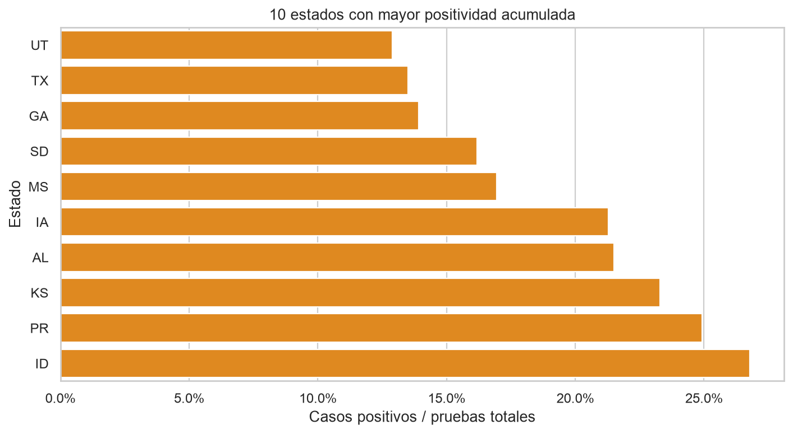
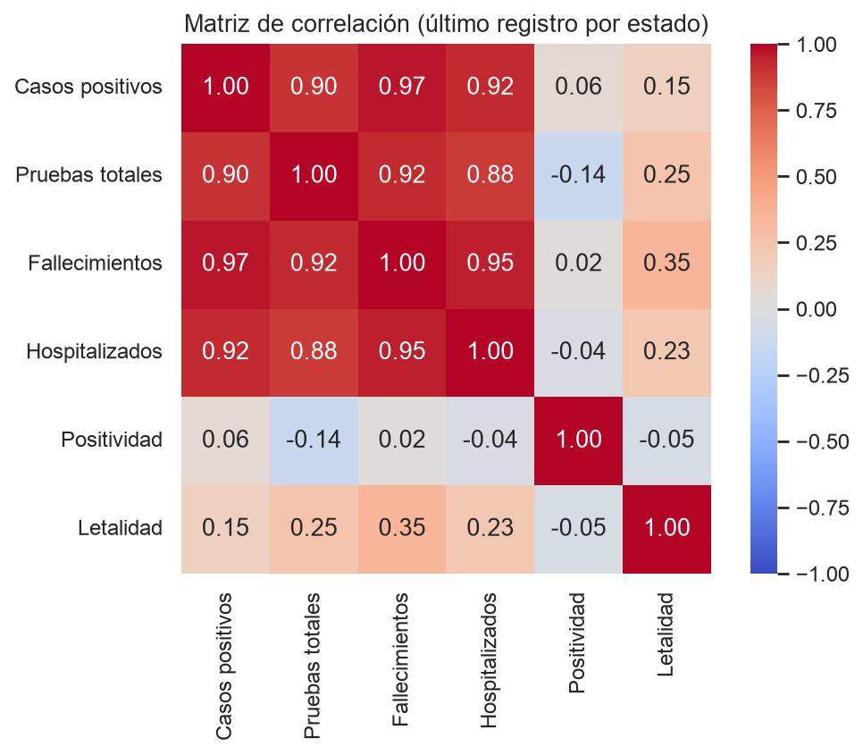

# Informe ejecutivo

## COVID-19 en Estados Unidos: qué dicen los datos (enero 2020 – marzo 2021)

## Resumen ejecutivo

Entre enero de 2020 y marzo de 2021 se registraron **20.780 observaciones diarias** de **56 estados y territorios** de Estados Unidos. Al final del periodo, la suma de los últimos registros de cada estado asciende a aproximadamente **28,8 millones de casos** y **515.000 fallecimientos**.

- **La pandemia llegó en olas.** El máximo diario de casos se alcanzó el 8 de enero de 2021 (295.121) y el de fallecimientos el 12 de febrero de 2021 (5.427). Diciembre de 2020 fue el mes con más casos (6,32 millones) y enero de 2021 el de más fallecimientos (95.387).
- **El impacto está muy concentrado.** California, Texas, Florida y Nueva York reúnen el mayor número de casos acumulados del país.
- **Pruebas y casos van de la mano.** La correlación entre pruebas totales y casos positivos por estado es de **0,90**: los estados que más prueban son también los que más casos detectan, aunque esto no demuestra causalidad.
- **Los ratios cambian la lectura.** La positividad más alta aparece en Idaho (26,8 %), Puerto Rico (24,9 %) y Kansas (23,3 %); la tasa de letalidad más alta, en Nueva Jersey (2,9 %), Massachusetts (2,8 %) y Connecticut (2,7 %).

**Recomendación principal:** comparar los estados por población y por ratios, no solo por totales, antes de asignar recursos.

## 1. Los datos y la limpieza

La fuente es el **COVID Tracking Project**, que recopiló datos públicos de casos, pruebas, hospitalizaciones y fallecimientos por estado hasta marzo de 2021. El conjunto original tiene 20.780 filas y 56 columnas; tras la limpieza se conservaron **10 variables relevantes**.

Decisiones de limpieza:

- Se eliminaron 46 columnas: metadatos, puntuaciones internas y variables con más del 74 % de nulos.
- La fecha se convirtió de entero (`AAAAMMDD`) a fecha real y el estado a variable categórica.
- Los acumulados se rellenaron con el último valor conocido del mismo estado (`ffill`); no se imputaron las medidas instantáneas como `hospitalizados_actuales`.
- Se conservaron los incrementos negativos porque son correcciones retroactivas de los estados, no errores.

La regla del rango intercuartílico (IQR) marcó como atípicos el **11,5 % de los casos nuevos**, el **10,6 % de los fallecimientos nuevos** y el **9,8 % de las pruebas nuevas**. Decidimos **no eliminarlos**: son picos reales de la epidemia o correcciones de reporte, no errores de medición. Para resumir variables tan asimétricas usamos medianas y ratios.

## 2. Qué encontramos

### 2.1. Una evolución marcada por las olas

La serie diaria muestra tres grandes olas: primavera de 2020, verano de 2020 e invierno de 2020-2021. La media móvil de 7 días suaviza los picos y las correcciones puntuales y deja ver la tendencia real.

El pico diario del 8 de enero de 2021 no fue un caso aislado: fue el final de una ola sostenida que concentró **6,32 millones de casos en diciembre de 2020**. Los fallecimientos siguieron a los casos con unas semanas de retraso y alcanzaron su máximo en enero y febrero de 2021.

### 2.2. Unos pocos estados concentran los casos; los ratios revelan otro mapa

California lidera el ranking con unos 3,5 millones de casos, seguida de Texas (2,7 M), Florida (1,9 M) y Nueva York (1,7 M). Son también algunos de los estados más poblados, por lo que la comparación en términos absolutos debe matizarse.

Al calcular la **positividad** (casos positivos / pruebas totales) aparecen estados que no lideran los totales: Idaho (26,8 %), Puerto Rico (24,9 %) y Kansas (23,3 %). La **tasa de letalidad** (fallecimientos / casos) es más alta en Nueva Jersey (2,9 %), Massachusetts (2,8 %) y Connecticut (2,7 %).

### 2.3. Más pruebas se asocian con más casos detectados

Cada punto de la matriz representa un estado en su último registro. Los acumulados están muy correlacionados entre sí: casos y pruebas (**0,90**), casos y fallecimientos (**0,97**), fallecimientos y hospitalizados (**0,95**). Es esperable, porque todos crecen con la población y con el tiempo.

Los ratios rompen ese patrón: la positividad apenas correlaciona con los casos (**0,06**) y la letalidad muestra una relación débil con los fallecimientos (**0,35**). El tamaño del estado explica los totales, pero no la intensidad ni la gravedad relativa.

## 3. Conclusiones

- La COVID-19 afectó de forma **desigual** al país: unos pocos estados concentran la mayor parte de los casos y fallecimientos.
- La evolución temporal muestra **olas claras**, con el pico de casos a principios de 2021 y el de fallecimientos unas semanas después.
- Existe una **relación positiva fuerte entre pruebas y casos**, coherente con la dinámica de detección, pero no causal.
- La limpieza fue imprescindible: muchas columnas casi vacías, fechas codificadas como números y correcciones negativas en los incrementos.
- Los **ratios de positividad y letalidad** ofrecen una lectura más justa que los totales, aunque siguen condicionados por las diferencias de reporte entre estados.

## 4. Recomendaciones

- Normalizar por población antes de comparar el impacto relativo entre estados.
- Seguir la evolución con **medias móviles** para separar tendencias de correcciones puntuales.
- Analizar los ratios junto con la calidad del reporte de cada estado, no de forma aislada.
- Ampliar el análisis con datos de vacunación y movilidad para las etapas posteriores a marzo de 2021.

## Limitaciones

Los datos son acumulados y absolutos y dependen de las diferencias de criterio y calidad de reporte entre estados. El periodo termina en marzo de 2021, antes de la vacunación masiva. El informe resume un análisis exploratorio y no establece relaciones causales; los ratios calculados con acumulados son aproximaciones descriptivas.
